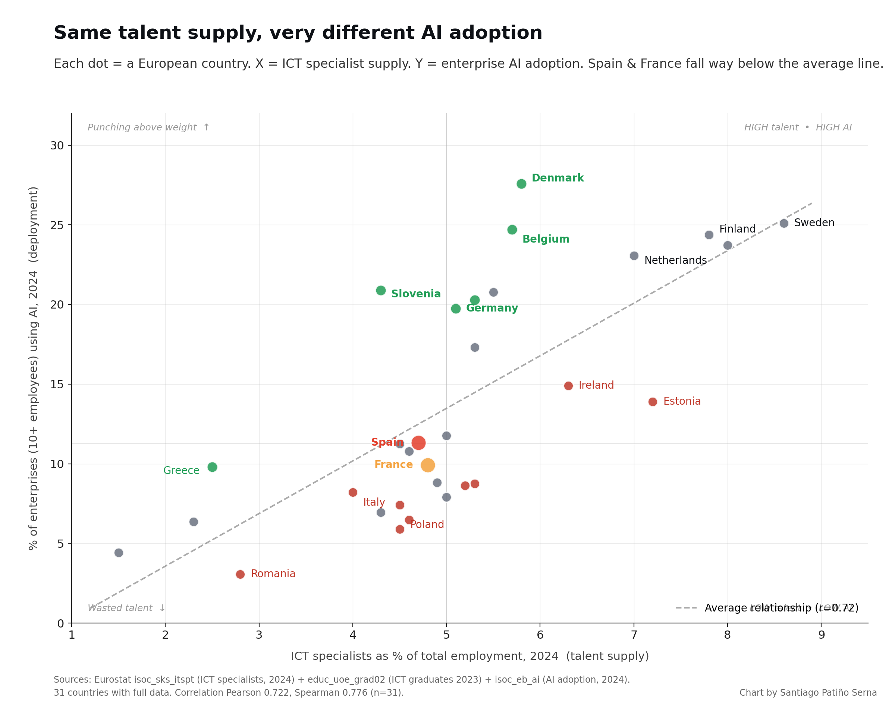
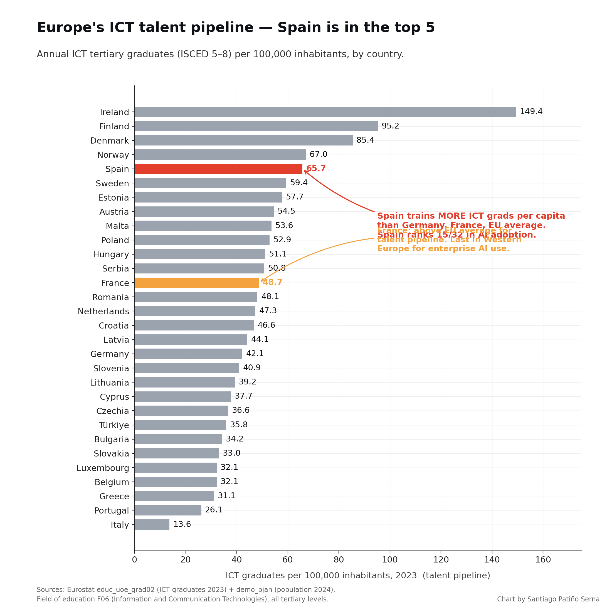
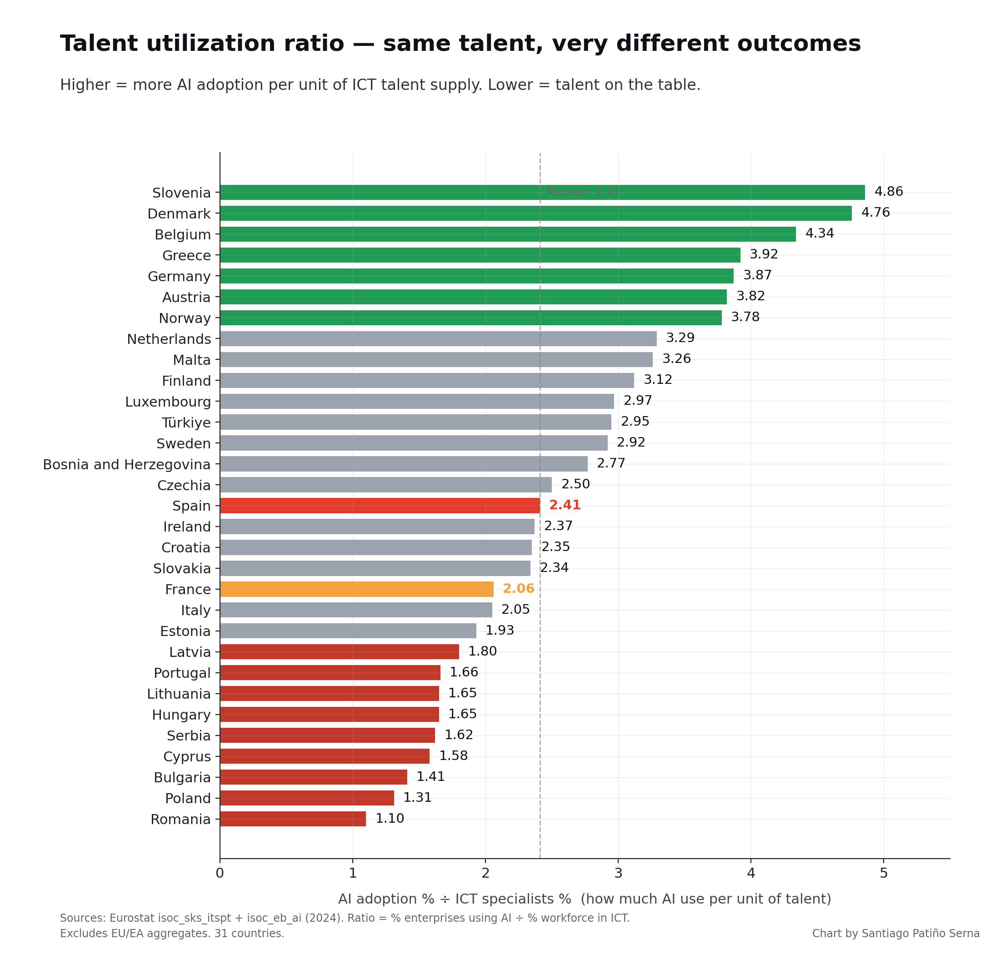

# EU AI talent vs adoption — the gap nobody likes to quote

**Second part of a public-data analysis on European enterprise AI** (follows [eu-ai-adoption-2024](https://github.com/santiagopatinoserna/eu-ai-adoption-2024), where the headline was: cost is the 6th barrier, expertise is the 1st at 70.89%).

> **TL;DR.** If 70.89% of EU companies blame "lack of expertise" for not adopting AI, does the data support that? **Partially.** Talent supply correlates with AI adoption (Pearson 0.722). But the variance under the line is enormous. **Spain produces more ICT graduates per capita than Germany — and uses half the AI.** France graduates above the EU average — and has the lowest enterprise AI adoption in Western Europe.

The expertise barrier is real. But for several Western European economies, the binding constraint is what happens AFTER the talent is hired.

---

## The headline chart



Each dot is a European country. X-axis = ICT specialists as % of total employment (talent supply, Eurostat 2024). Y-axis = % of enterprises with 10+ employees using AI (deployment, Eurostat 2024). The dashed line is the average relationship: Pearson r = 0.722 and Spearman 0.776 (n = 31 countries with all three datasets).

**Spain and France sit way below the line.** Slovenia, Denmark, Belgium, Greece sit way above.

---

## Spain's paradox



Spain trains **65.7 ICT graduates per 100,000 inhabitants per year** (Eurostat 2023) — more than Germany (42.1), France (48.7), and the EU average (47.3). Spain produces 31,927 ICT graduates per year in absolute terms.

Spain ranks 5th in Europe by ICT graduate output per capita. Spain ranks **15th of 32** in enterprise AI adoption (11.31%).

The talent pipeline is healthy. The deployment is not.

---

## The utilization gap



For each country, this is the ratio of AI adoption (%) to ICT specialist supply (%). Higher = more AI per unit of talent. Lower = talent on the table.

Slovenia: **4.86** — gets the most AI deployment out of its talent base.
Denmark: 4.76. Belgium: 4.34. Germany: 3.87.

Spain: **2.41**. France: **2.06**. Italy: 2.05.

---

## Key cross-tab — Top + bottom

| Rank | Country | ICT specialists (% emp) | ICT grads / 100k | AI adoption (% ent) | AI/ICT ratio |
|---|---|---:|---:|---:|---:|
| 1 | Slovenia | 4.3 | 40.9 | **20.89** | **4.86** |
| 2 | Denmark | 5.8 | 85.4 | 27.58 | 4.76 |
| 3 | Belgium | 5.7 | 32.1 | 24.71 | 4.34 |
| 4 | Greece | 2.5 | 31.1 | 9.81 | 3.92 |
| 5 | Germany | 5.1 | 42.1 | 19.75 | 3.87 |
| ... | | | | | |
| 21 | Spain | 4.7 | **65.7** | 11.31 | **2.41** |
| 24 | France | 4.8 | 48.7 | 9.91 | 2.06 |
| 25 | Italy | 4.0 | 13.6 | 8.20 | 2.05 |
| 31 | Romania | 2.8 | 48.1 | 3.07 | 1.10 |

---

## Reproduce in 60 seconds

```bash
git clone https://github.com/santiagopatinoserna/eu-ai-talent-vs-adoption-2024.git
cd eu-ai-talent-vs-adoption-2024
pip install pandas matplotlib numpy
python scripts/fetch.py      # downloads 3 Eurostat datasets to data/
python scripts/analyze.py    # cross-tabs + correlation + 1 joined CSV
python scripts/chart.py      # 3 PNG charts
```

No API key required.

---

## Repository layout

```
.
├── data/
│   ├── ict_specialists_raw.json       ← Eurostat isoc_sks_itspt 2024
│   ├── ict_graduates_raw.json         ← Eurostat educ_uoe_grad02 2023
│   ├── population_raw.json            ← Eurostat demo_pjan 2024
│   ├── ai_tany_all.csv                ← AI adoption, copied from eu-ai-adoption-2024 (Eurostat isoc_eb_ai)
│   └── talent_vs_adoption.csv         ← joined country-level dataframe
├── scripts/
│   ├── fetch.py     ← pulls 3 Eurostat datasets
│   ├── analyze.py   ← cross-tab + correlation
│   └── chart.py     ← matplotlib charts
├── charts/
│   ├── chart_scatter_talent_vs_ai.png
│   ├── chart_graduates_per_100k.png
│   └── chart_utilization_gap.png
├── README.md
└── LICENSE
```

---

## Methodology & caveats

- **Sources.** Three Eurostat datasets, all free and public:
  - `isoc_sks_itspt` — Employed ICT specialists (2024)
  - `educ_uoe_grad02` — Tertiary graduates by field (2023, ISCED 5–8, field F06 = ICT)
  - `demo_pjan` — Population 1 January 2024
  - Plus the `isoc_eb_ai` AI adoption cross-tab from the companion repo (bundled).
- **Correlation isn't causation.** A country's ICT specialist supply correlates with its AI adoption, but other factors (regulation, capital availability, language, sector mix) also vary.
- **ICT graduates ≠ AI graduates.** ISCED field F06 includes broad ICT — not just AI/ML. Spain's high graduate count includes computer science generalists, telecoms engineers, software engineers, etc.
- **Brain drain not measured here.** Ireland's 149.4 graduates per 100k partly leak to US tech companies — Eurostat measures graduates produced, not graduates retained.
- **Self-reported AI adoption.** Same caveat as in the companion repo: enterprises may over- or under-state "we use AI."

---

## Companion repo

- Part 1: [eu-ai-adoption-2024](https://github.com/santiagopatinoserna/eu-ai-adoption-2024) — the barriers analysis (cost ranks 6th, expertise ranks 1st at 70.89%).

---

## License

- **Code (scripts/):** MIT
- **Charts:** CC BY 4.0 — attribute "Chart by Santiago Patiño Serna, data: Eurostat"
- **Eurostat data:** © European Union, redistributed under Eurostat's [free re-use policy](https://ec.europa.eu/eurostat/about-us/policies/copyright)

---

## Author

Santiago Patiño Serna — [LinkedIn](https://www.linkedin.com/in/santiagopatinoserna/)

Issues and PRs welcome.
